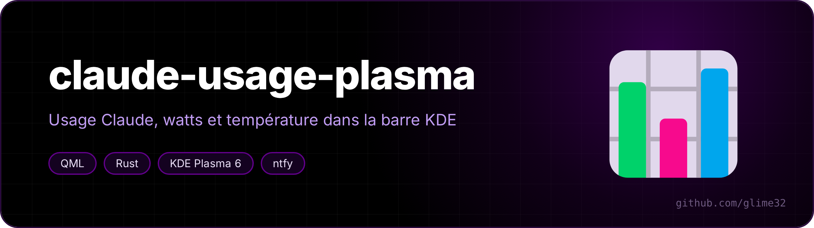
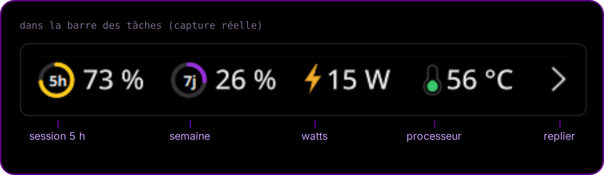
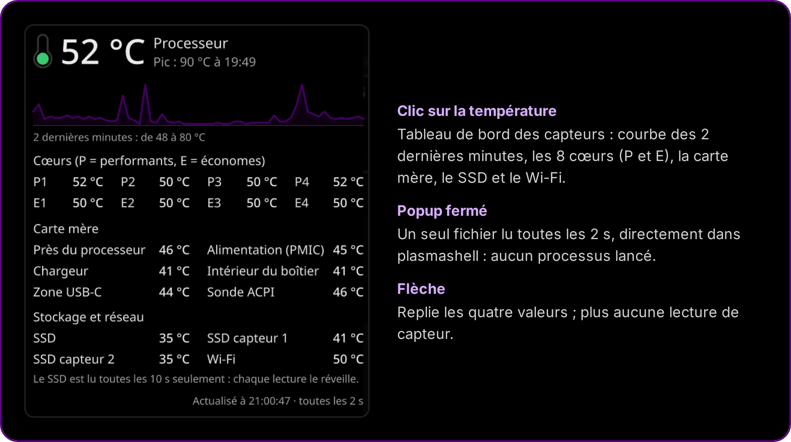
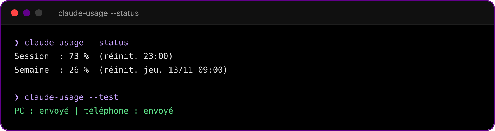

<p align="center"></p>

<p align="center">  </p>

<p align="center"><a href="README.md">🇬🇧 English version</a></p>

**Un widget pour la barre des tâches KDE Plasma : ton usage de Claude (session de 5 h et limite de la semaine), la consommation du PC en watts et la température du processeur. Et une notification sur le PC et le téléphone quand une limite se réinitialise.**

<p align="center"></p>

## Ce qu'il affiche

- **Anneaux 5h et 7j** : ton usage de Claude sur la session et sur la semaine, les mêmes chiffres que *Paramètres → Utilisation* sur claude.ai. Survole pour voir l'heure de réinitialisation.
- **Watts** : la consommation de tout le PC, lue sur le compteur RAPL `psys` (marche aussi sur secteur), ou sur la batterie quand le PC est débranché.
- **Température du processeur**, avec un petit thermomètre. Un clic ouvre le tableau de bord des capteurs.
- **Flèche** : replie les quatre valeurs. Replié, le widget ne lit plus aucun capteur.
- **Une pastille par fenêtre Claude Code ouverte**, si tu utilises aussi [claude-launcher-kde](https://github.com/glime32/claude-launcher-kde) : pleine = à toi de jouer, anneau = Claude travaille, « ! » = Claude attend ton accord. Au survol, le titre de la conversation ; un clic met la fenêtre au premier plan. Les pastilles restent visibles même replié.

<p align="center"></p>

## Notifications de réinitialisation

Quand une limite revient à 0 %, tu reçois une notification sur le bureau. Avec un topic [ntfy](https://ntfy.sh) dans la config, ton téléphone en reçoit une aussi. Elle est programmée à l'avance sur le serveur ntfy (`delay`) : elle arrive à l'heure même si le PC est en veille.

<p align="center"></p>

## Installation

Il faut KDE Plasma 6, Rust pour compiler l'assistant (`sudo pacman -S rust`), `curl`, et [Claude Code](https://claude.com/claude-code) connecté au moins une fois (le widget réutilise sa connexion).

```bash
git clone https://github.com/glime32/claude-usage-plasma && cd claude-usage-plasma && ./install.sh
```

Ensuite : clic droit sur la barre des tâches → *Ajouter des widgets* → **Usage Claude**.

Pour le téléphone : installe l'appli ntfy, abonne-toi à un topic long et aléatoire, mets-le dans `~/.config/claude-usage/config.json` (`"ntfy_topic"`), puis lance `claude-usage --test`.

### En option

- **Watts sur secteur** : les compteurs RAPL ne sont lisibles que par root. `extras/99-rapl-psys.rules` les rend lisibles par ton groupe (mets d'abord le nom de ton groupe dedans). `intel-rapl:1` = `psys` sur un PC Intel Lunar Lake ; vérifie avec `cat /sys/class/powercap/intel-rapl:*/name` sur le tien.
- **Zéro processus** : avec `extras/xhr.conf` copié dans `~/.config/systemd/user/plasma-plasmashell.service.d/`, plasmashell lit lui-même les fichiers des capteurs au lieu de lancer `cat` toutes les 2 s.

## Léger pour la batterie

- Pas de démon. Le widget lance `claude-usage` toutes les 10 à 30 minutes, plus un minuteur à l'heure de réinitialisation et une vérification au réveil. L'assistant est en Rust depuis la version 2 : une vingtaine de ms de processeur par appel au lieu d'environ 50 pour l'ancien script Python, avec les mêmes fichiers et le même JSON. Les jetons passent à `curl` par l'entrée standard, jamais dans la ligne de commande.
- Les pastilles Claude lisent quelques petits fichiers dans `$XDG_RUNTIME_DIR/claude-couleurs/` toutes les 2 s, sans lancer de processus, et ne redessinent que si quelque chose a changé.
- Au plus un appel à l'API toutes les 2 minutes, et 5 minutes de pause après un refus « trop de requêtes » (HTTP 429).
- Aucune animation, et la valeur de la barre n'est redessinée que si le changement se voit.
- Lire la température du SSD le réveille : elle n'est lue que tableau de bord ouvert, toutes les 10 s.
- Les capteurs sont repérés une seule fois au démarrage (`plasmoid/contents/code/sensors.sh`), car les numéros `hwmonN` changent d'un démarrage à l'autre.

> [!NOTE]
> Les chiffres d'usage viennent de l'adresse qu'utilise claude.ai pour sa propre page d'utilisation (`/api/oauth/usage`). Ce n'est pas une API documentée : elle peut changer. Quand le jeton d'accès a expiré, l'assistant le renouvelle comme le fait Claude Code et le réécrit dans `~/.claude/.credentials.json`.

## Désinstaller

```bash
./uninstall.sh
```
