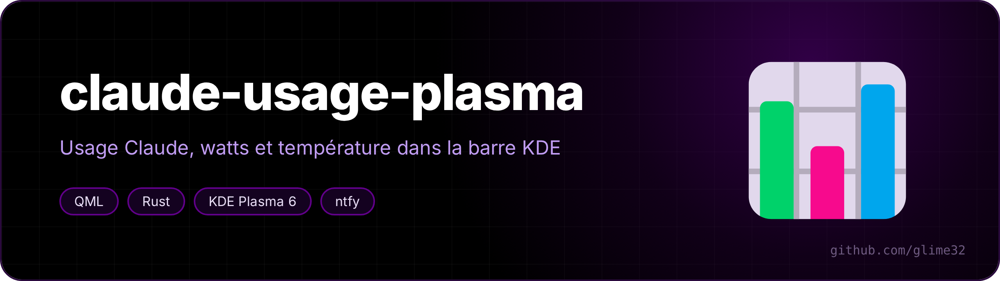
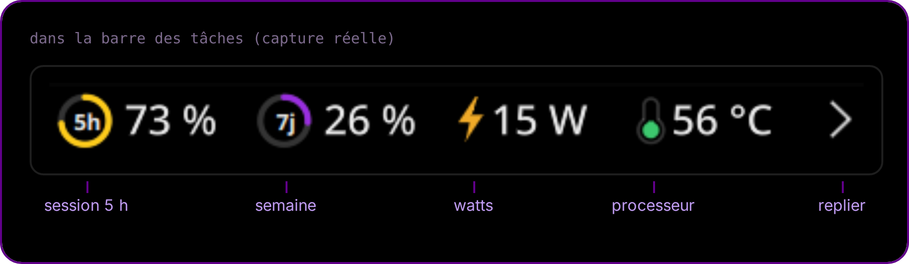
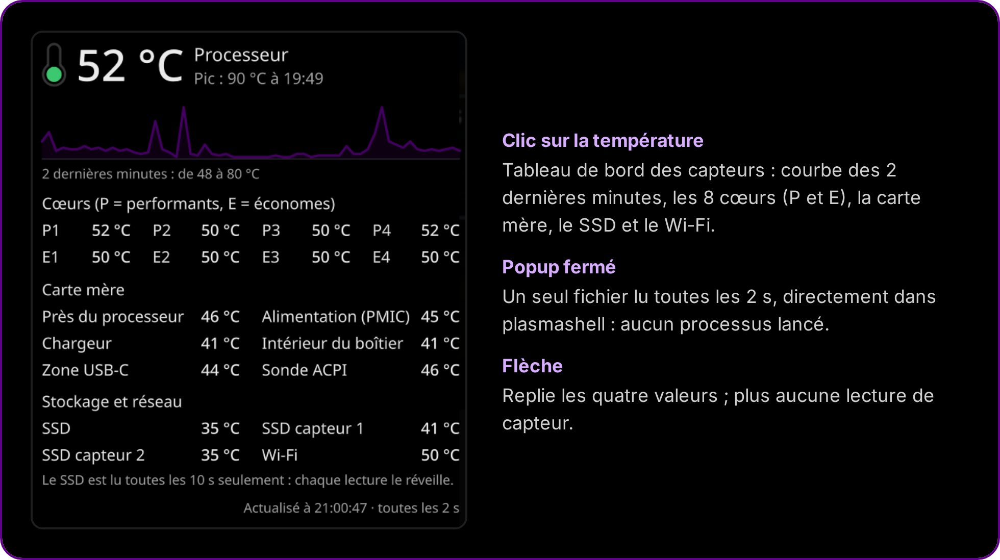
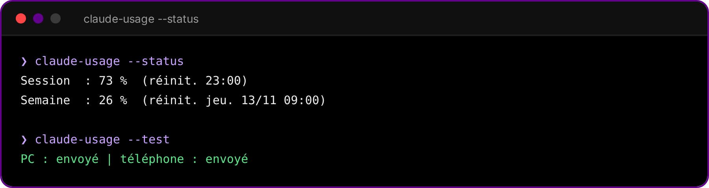

<p align="center"></p>

<p align="center">  </p>

<p align="center"><a href="README.fr.md">🇫🇷 Version française</a></p>

**A KDE Plasma panel widget that shows your Claude usage (5-hour session and weekly limit), the laptop's power draw in watts and the CPU temperature, plus reset notifications on your PC and your phone.**

<p align="center"></p>

## What it shows

- **5h ring and 7j ring**: your Claude session and weekly usage, the same numbers as *Settings → Usage* on claude.ai. Hover for the exact reset time.
- **Watts**: the whole laptop's power draw, from the RAPL `psys` counter (works on AC too), or from the battery when unplugged.
- **CPU temperature** with a small thermometer. Click it to open a sensor dashboard.
- **Arrow**: folds the four values away. Folded, the widget reads no sensor at all.
- **One dot per open Claude Code window**, if you also use [claude-launcher-kde](https://github.com/glime32/claude-launcher-kde): filled = your turn, ring = Claude is working, "!" = Claude waits for your approval. Hover for the conversation title; click to bring the window to front. Dots stay visible when folded.

<p align="center"></p>

## Reset notifications

When a limit goes back to 0 %, you get a desktop notification. With an [ntfy](https://ntfy.sh) topic in the config, your phone gets one too. It is scheduled on the ntfy server in advance (`delay`), so it arrives on time even if the PC is asleep.

<p align="center"></p>

## Google Calendar (optional)

`claude-usage` can also put an event in your primary Google Calendar at each weekly reset, and at the 5-hour reset when the 5-hour limit hit 100 %. A phone synced with the account shows it too. The event moves if the reset time changes, and stays in the calendar once it has passed. Each one carries a private `claude-usage` property: an event without it is never changed or deleted.

Once:

1. In the Google Cloud console: create a project, enable the Google Calendar API, set up the consent screen (External) and publish it "In production". In "Testing", Google stops the access after 7 days.
2. Create an OAuth client of type "Desktop app" and download its JSON file.
3. Run `claude-usage --agenda path/to/client_secret.json` and allow access in the browser. Google warns that the app is not verified: it is your own app, choose "Advanced" and continue.

The calendar sync only runs right after a successful usage call, and only calls Google when an event has to be added, moved or removed.

## Install

Needs KDE Plasma 6, Rust to build the helper (`sudo pacman -S rust`), `curl`, and [Claude Code](https://claude.com/claude-code) logged in once (the widget reuses its login).

```bash
git clone https://github.com/glime32/claude-usage-plasma && cd claude-usage-plasma && ./install.sh
```

Then right-click the panel → *Add widgets* → **Usage Claude**.

For phone notifications, install the ntfy app, subscribe to a long random topic, put it in `~/.config/claude-usage/config.json` (`"ntfy_topic"`), then run `claude-usage --test`.

### Optional

- **Watts on AC**: the RAPL counters are root-only by default. `extras/99-rapl-psys.rules` lets your group read them (edit the group name first). The `intel-rapl:1` = `psys` mapping is the one on an Intel Lunar Lake laptop; check `cat /sys/class/powercap/intel-rapl:*/name` on yours.
- **Zero processes**: with `extras/xhr.conf` copied to `~/.config/systemd/user/plasma-plasmashell.service.d/`, plasmashell reads the sensor files itself instead of running `cat` every 2 s.

## Light on battery

- No daemon. The widget runs `claude-usage` every 10 to 30 minutes, plus a one-shot timer at the reset time and a check after resume from sleep. The helper is Rust since version 2: about 20 ms of CPU per call instead of ~50 for the old Python script, same files and same JSON. Tokens reach `curl` through stdin, never on the command line.
- The Claude dots read a few small files in `$XDG_RUNTIME_DIR/claude-couleurs/` every 2 s without spawning anything, and only redraw when something changed.
- At most one API call every 2 minutes, and 5 minutes of silence after an HTTP 429.
- No animation, and the panel value only redraws when the change is visible (hysteresis).
- The NVMe temperature wakes the SSD, so it is only read while the dashboard is open, every 10 s.
- Sensors are found once at startup (`plasmoid/contents/code/sensors.sh`), because `hwmonN` numbers move between boots.

> [!NOTE]
> The usage numbers come from the endpoint claude.ai uses for its own usage page (`/api/oauth/usage`). It is not a documented API and could change. When the access token has expired, the helper refreshes it the same way Claude Code does and writes it back to `~/.claude/.credentials.json`.

## Privacy

Everything stays on your PC. The helper only talks to Anthropic (the usage numbers), to your ntfy server if you set a topic, and to Google Calendar if you connected it. The Google token is kept in `~/.config/claude-usage/google.json`, readable by you only. The app only asks for access to events on calendars you own, and only writes, moves or deletes its own events. Nothing is sent anywhere else. To disconnect the calendar: delete that file and remove the app at https://myaccount.google.com/permissions.

## Uninstall

```bash
./uninstall.sh
```
