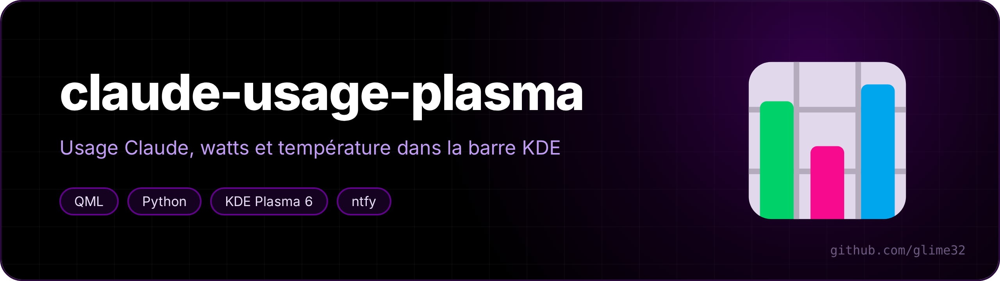
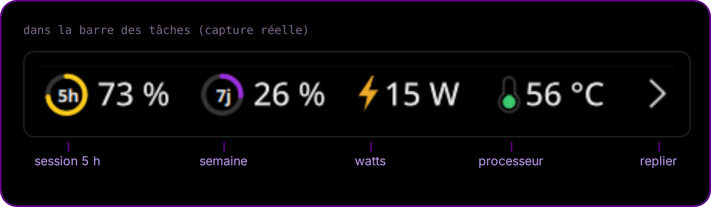
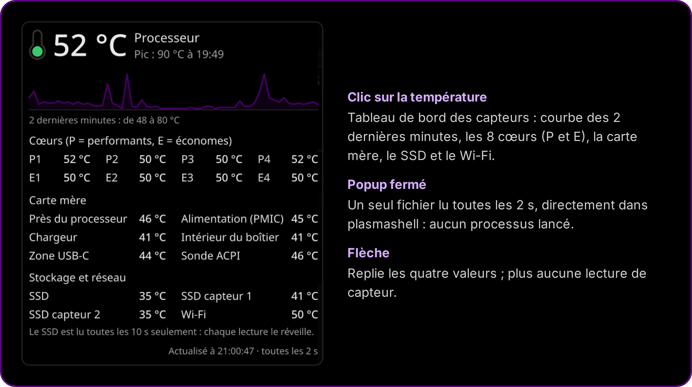
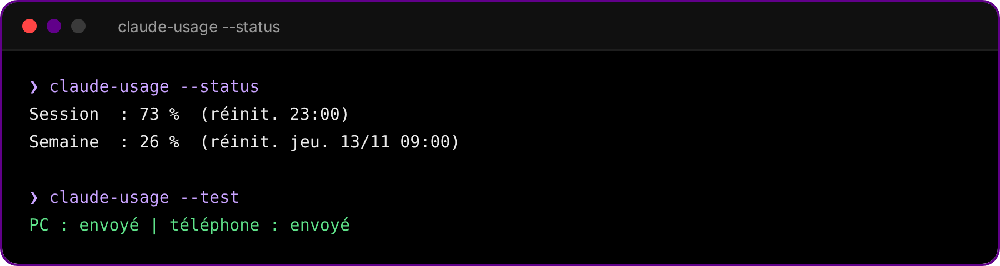

<p align="center"></p>

<p align="center">  </p>

<p align="center"><a href="README.fr.md">🇫🇷 Version française</a></p>

**A KDE Plasma panel widget that shows your Claude usage (5-hour session and weekly limit), the laptop's power draw in watts and the CPU temperature, plus reset notifications on your PC and your phone.**

<p align="center"></p>

## What it shows

- **5h ring and 7j ring**: your Claude session and weekly usage, the same numbers as *Settings → Usage* on claude.ai. Hover for the exact reset time.
- **Watts**: the whole laptop's power draw, from the RAPL `psys` counter (works on AC too), or from the battery when unplugged.
- **CPU temperature** with a small thermometer. Click it to open a sensor dashboard.
- **Arrow**: folds the four values away. Folded, the widget reads no sensor at all.

<p align="center"></p>

## Reset notifications

When a limit goes back to 0 %, you get a desktop notification. With an [ntfy](https://ntfy.sh) topic in the config, your phone gets one too. It is scheduled on the ntfy server in advance (`delay`), so it arrives on time even if the PC is asleep.

<p align="center"></p>

## Install

Needs KDE Plasma 6, Python 3 (standard library only) and [Claude Code](https://claude.com/claude-code) logged in once (the widget reuses its login).

```bash
git clone https://github.com/glime32/claude-usage-plasma && cd claude-usage-plasma && ./install.sh
```

Then right-click the panel → *Add widgets* → **Usage Claude**.

For phone notifications, install the ntfy app, subscribe to a long random topic, put it in `~/.config/claude-usage/config.json` (`"ntfy_topic"`), then run `claude-usage --test`.

### Optional

- **Watts on AC**: the RAPL counters are root-only by default. `extras/99-rapl-psys.rules` lets your group read them (edit the group name first). The `intel-rapl:1` = `psys` mapping is the one on an Intel Lunar Lake laptop; check `cat /sys/class/powercap/intel-rapl:*/name` on yours.
- **Zero processes**: with `extras/xhr.conf` copied to `~/.config/systemd/user/plasma-plasmashell.service.d/`, plasmashell reads the sensor files itself instead of running `cat` every 2 s.

## Light on battery

- No daemon. The widget runs `claude-usage` every 10 to 30 minutes (about 50 ms of CPU), plus a one-shot timer at the reset time and a check after resume from sleep.
- At most one API call every 2 minutes, and 5 minutes of silence after an HTTP 429.
- No animation, and the panel value only redraws when the change is visible (hysteresis).
- The NVMe temperature wakes the SSD, so it is only read while the dashboard is open, every 10 s.
- Sensors are found once at startup (`plasmoid/contents/code/sensors.sh`), because `hwmonN` numbers move between boots.

> [!NOTE]
> The usage numbers come from the endpoint claude.ai uses for its own usage page (`/api/oauth/usage`). It is not a documented API and could change. When the access token has expired, the script refreshes it the same way Claude Code does and writes it back to `~/.claude/.credentials.json`.

## Uninstall

```bash
./uninstall.sh
```
